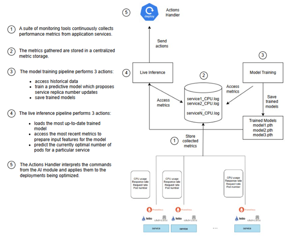

# Architecture and data flow

Headlight closes a control loop across application metrics, forecasting,
placement decisions, and Kubernetes state:

```text
Locust/workload -> application + Istio/cAdvisor -> Prometheus
       -> AI Module (features + frozen model) -> Actions Handler
       -> ControlledReplicaPropagation -> Karmada -> member clusters
```



The relocated component diagrams are retained in [`assets/`](assets/), including
the metrics collection pipeline and component context views.

The AI Module is the policy client. It reads aligned metrics, applies the
versioned service profile and hash-verified model bundle, then proposes desired
replicas. The Actions Handler is a narrow REST and batching boundary: it accepts
placement actions and periodically patches CRP resources through the Karmada API.
CRP is the enforcement boundary. Its controller creates capacity before
deleting capacity and uses `maxUnavailable` and readiness to preserve the
configured availability invariant during cross-cluster replica migration.

Training is offline and separate from live inference. Live inference loads a
frozen, hash-verified model bundle and does not continuously retrain. The active
Headlight forecaster uses this implemented path:

```text
input projection -> temporal scoring/aggregation -> graph message passing
                 -> multitask output head
```

Each service timestep has seven base features: `replicas`, `request_rate`,
`cpu_usage_cores`, `cpu_utilization`, `mean_latency_ms`, `p95_latency_ms`, and
`error_rate`. Each base feature is paired with a missing-value indicator, giving
14 model input channels. The output head returns `request_q50`, `request_q90`,
`cpu_q90`, `p95_latency_q90`, and `sla_violation_logit`; decoded runtime
forecasts expose the final channel as an SLA-violation probability.

The forecasting graph is a service-level adjacency over the ordered service
profile. The static adjacency is row-normalized traffic adjacency with self
loops, and the active model applies the bounded learnable residual permitted by
the current code's observed/two-hop residual mask. Legacy Chebyshev and
temporal-convolution model modules remain for provenance and comparison only;
they are not the active frozen-bundle forecaster.

The dry-run runner exercises configuration resolution and planned stages without
touching Kubernetes. A measured run additionally records versions, raw traces,
cluster events, CRP transitions, and validated summaries. These are different
validation classes and must not be conflated.
