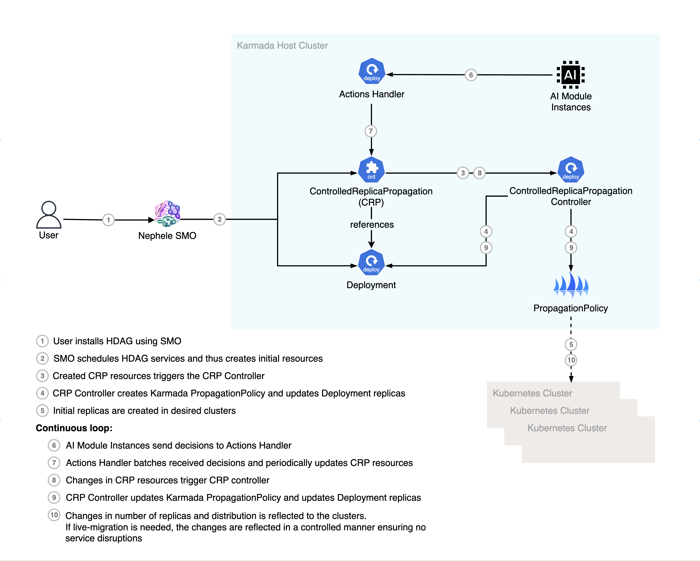

# Actions Handler



The Actions Handler exposes a REST boundary for placement decisions. It accepts
placement lists, stores them in `BATCH_PLACEMENTS_DIR`, removes duplicates, and
submits updates to Karmada on `BATCH_SUBMIT_CRON`. The service is intended to be
reachable through the multi-cluster Istio service mesh.

The endpoint is `POST /placements` at
`actions-handler.actions-handler-system.svc.cluster.local:8080`:

```bash
curl -X POST http://actions-handler.actions-handler-system.svc.cluster.local:8080/placements \
  -H 'Content-Type: application/json' \
  -d '[{"workload":{"apiVersion":"apps/v1","kind":"Deployment","namespace":"default","name":"crp-example"},"clusterName":"cluster2","replicas":5}]'
```

Configuration uses `BATCH_PLACEMENTS_DIR`, `KARMADA_CONFIG_PATH`, and
`BATCH_SUBMIT_CRON`. Deployment manifests are under `config/` and `dist/`;
component tests run with `just test`. The dry-run checks do not deploy this
service or constitute measured evidence.
