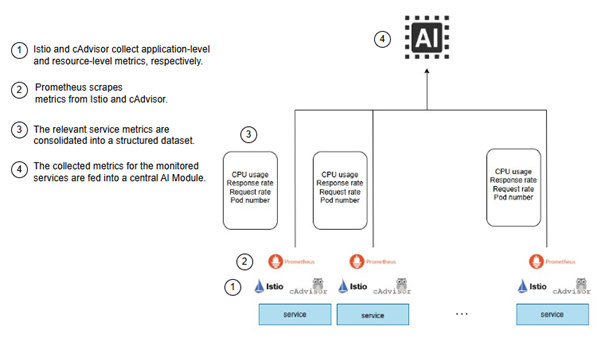

# AI Module



The AI Module collects Prometheus metrics, converts them to the service-profile
feature schema, loads one immutable hash-verified model bundle, and emits
placement actions. Training is offline, and live inference uses a frozen bundle
without retraining. The active Headlight bundle contains a checkpoint, scaler,
feature schema, service profile, adjacency, capacity, model config, learned
edges, and metadata hashes.

The active forecaster uses seven base metrics: `replicas`, `request_rate`,
`cpu_usage_cores`, `cpu_utilization`, `mean_latency_ms`, `p95_latency_ms`, and
`error_rate`. Each is paired with a missing-value indicator, giving 14 model
input channels. The implemented architecture is input projection, temporal
scoring/aggregation, graph message passing, and a multitask output head. The
forecasting graph is a service-level adjacency over the ordered service profile
with the bounded learnable residual implemented by `headlight.graph`.

The current model outputs are `request_q50`, `request_q90`, `cpu_q90`,
`p95_latency_q90`, and `sla_violation_logit`; decoded runtime forecasts expose
the last channel as an SLA-violation probability. Legacy model modules are
retained for provenance and comparison only.

Train and run the runtime with the package entry points:

```bash
cd ai-module/ai-module
python train_model.py --once --controller headlight --help
python live_inference.py --help
```

Deployment setup and baseline scripts are in `ai-module/`. The dry-run path
checks configuration and bundle contracts and demonstrates sample output format.
Measured model-quality and autoscaling tables use the measured artifact
workflow.
